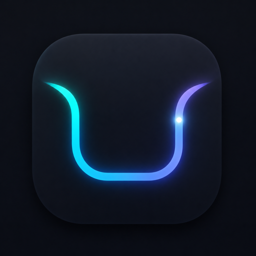

<p align="center"></p>

<h1 align="center">n0tch</h1>

<p align="center"><strong>The notch, finally useful.</strong><br>A native macOS app that turns the notch into now-playing controls, volume and brightness lines, download progress, a shelf, timers, and a spinning record on your lock screen.</p>

<p align="center">
  <a href="https://n0tch.alvinyeboah.com">Website</a> ·
  <a href="https://github.com/alvinyeboah/n0tch/releases/latest">Download</a> ·
  <a href="CHANGELOG.md">Release notes</a> ·
  <a href="https://github.com/alvinyeboah/n0tch/issues">Feedback</a>
</p>

<p align="center">
  
  
  
  
</p>

n0tch is written in **Swift, SwiftUI and AppKit**. There is no web view, no account, no analytics and no telemetry. The only network requests it can make are a once-a-day check for a newer version and an optional album cover lookup; both can be switched off.

> **Developer preview.** n0tch is early software shared for testing and feedback. Read [Status and known limits](#status-and-known-limits) first.

## Download and install

**Requirements:** a Mac with Apple Silicon and **macOS 14 or later**. The lock screen record was tested on macOS 27.

1. Download `n0tch-0.1.1.dmg` from the [latest release](https://github.com/alvinyeboah/n0tch/releases/latest).
2. Open it and drag **n0tch** to **Applications**.
3. Open n0tch. When asked, allow **Accessibility** so it can handle the volume and brightness keys and scrolling over the notch.

Every release is signed with a Developer ID certificate and notarized by Apple. After this first install n0tch updates itself (Settings → About), so you never need to download it again. Verify a download with:

```bash
shasum -a 256 n0tch-0.1.1.dmg
```

and compare it with `SHA256SUMS` on the release page.

## What it does

| | |
| --- | --- |
| **The line** | Volume, brightness, charging, battery warnings (30, 20, 10 and 5 percent) and timers draw a line around the notch instead of a system pop-up. |
| **Now playing** | Hover the notch for a frosted card with cover, progress and large controls. Follows Apple Music, Spotify, browser tabs and anything else that reports what is playing. |
| **Lock screen record** | While music plays and your Mac is locked, a large record spins above the lock screen. The needle lowers, the cover is the label, the ring is the progress. Experimental. |
| **Downloads** | Safari, Chrome and Firefox downloads trace their own progress, with a one-click Show in Finder. |
| **The shelf** | Drop a file, image, link or text on the notch. Drag it back out or send it to AirDrop. Items clear after an hour unless pinned. |
| **Activities** | A small `n0tch` command and hooks for Claude Code and Codex let scripts, builds and AI agents draw on the notch. |
| **Focus and timers** | Your Focus mode shows beside the notch. Start a timer and the line drains around it. |
| **One Settings window** | Haptics, size, which features are on, and a plain explanation of every switch. |

## Privacy

n0tch reads what is playing, volume, brightness, battery state, the names and progress of files in Downloads and your current Focus mode, all on your Mac. If your player does not supply a cover, it can ask Apple's public iTunes search for one, sending the song title and artist. That is the only thing that leaves your Mac. Full detail: <https://n0tch.alvinyeboah.com/privacy>.

## Security

See [SECURITY.md](SECURITY.md) and <https://n0tch.alvinyeboah.com/security>. Please report vulnerabilities privately.

## Status and known limits

- **Private macOS interfaces.** Now playing, brightness and the lock screen window use system interfaces with no public API. Apple can change them in any macOS update, which could switch a feature off. If one is missing, only that feature stops working.
- **The lock screen record is experimental.** It is only a picture: it cannot read what you type and ignores the mouse. You can turn it off in Settings.
- **Apple Silicon only** for now, and macOS 14 or later.
- **Spotify** shows what is playing and play/pause works. Favoriting in Spotify is not wired up yet.
- Not independently audited. One person builds this.

## Feedback

Open an [issue](https://github.com/alvinyeboah/n0tch/issues/new/choose). Please do not include private information.

## Source and licence

n0tch is **closed source**. This repository holds public release information, downloads and feedback, not the application source. © Alvin Yeboah. All rights reserved. It is free to download and use.

macOS, Apple Silicon, Safari, Apple Music and Spotify are trademarks of their owners. n0tch is an independent project and is not affiliated with or endorsed by Apple, Spotify or any other company mentioned.
